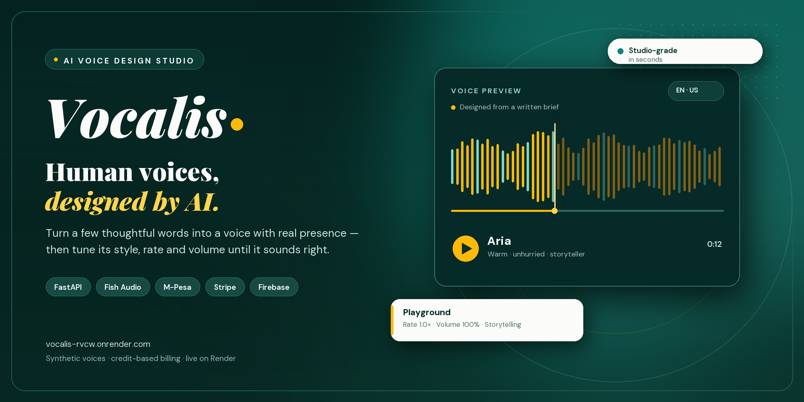

<p align="center">
  
</p>

<h1 align="center">Vocalis</h1>

<p align="center">
  <strong>Human voices, designed by AI.</strong><br/>
  Turn a written brief into a voice with real presence — then tune its style, rate and volume, synthesize speech, and manage everything with credit-based billing.
</p>

<p align="center">
  <a href="https://vocalis-rvcw.onrender.com/">
    
  </a>
  <a href="https://github.com/lyle-mlengineer/vocalis/actions/workflows/ci.yml">
    
  </a>
  
  
  
</p>

<p align="center">
  <a href="https://vocalis-rvcw.onrender.com/"><strong>Open the live app</strong></a> ·
  <a href="https://vocalis-rvcw.onrender.com/docs">API documentation</a> ·
  <a href="https://github.com/lyle-mlengineer/vocalis/issues">Report a bug</a> ·
  <a href="https://github.com/lyle-mlengineer/vocalis/issues">Request a feature</a>
</p>

> **The short version** — Describe a voice in plain language. Vocalis designs it from the brief, saves a preview you can play and download, and gives you a studio for re-tuning it. Try one voice as a guest; create an account to build a library, synthesize speech and top up with credits.

---

## What Vocalis does — and who it is for

**Vocalis is a voice-design studio for people who need a specific voice, not a generic one.** You write a short casting brief — gender, age range, ethnicity and a description of the sound you want — and receive a designed voice with a playable preview. From there you can refine the brief, organize voices into albums, and synthesize narration with adjustable rate, volume and style.

It is built for:

| You are… | Vocalis gives you… |
|---|---|
| A **content creator or podcaster** | A consistent narrator voice without booking a studio or a voice actor |
| A **developer building voice features** | A typed API for voice design and speech synthesis, plus a playground to audition settings |
| A **small team or agency** | Shared voice libraries organized into albums, with a predictable credit model |
| A **team in Kenya & East Africa** | Native M-Pesa billing in Kenyan shillings, with cards as a fallback |

The product is one deliberately simple loop: **brief → design → audition → refine → synthesize.**

## Product tour

| Capability | What you get |
|---|---|
| **Brief-to-voice studio** | A guided form capturing title, gender, age range, ethnicity and a detailed description of the voice |
| **Guest trial** | One free voice per guest session; register with the same browser to claim it automatically |
| **Voice library** | Every design in one place, with actions to preview, rename, download and delete |
| **Albums** | Group voices by project or persona, with titles and descriptions |
| **Playground** | Synthesize speech with style presets, speaking rate from 0.5× to 2.0× and volume from 0–100% |
| **Regenerate & refine** | Re-run a brief for a fresh take while keeping the same library entry |
| **Credits & billing** | A ledger, dashboard and credit packs paid by M-Pesa or card — no monthly subscription |
| **Accounts** | Email and password, plus Google sign-in through Firebase |

## How to use Vocalis

**1. Open the studio.** Visit [the live app](https://vocalis-rvcw.onrender.com/studio), or run it locally and go to `/studio`. No account is required to start.

**2. Write the brief.** Give the voice a title, then describe it: gender, age range, ethnicity, and the qualities you want to hear — warm, unhurried, authoritative, playful, accented in a particular way.

**3. Design the voice.** Vocalis sends the brief to the configured provider and returns a voice with a preview. The first guest voice is free; signed-in designs cost **1 credit** by default. Every credit is refunded automatically if the provider fails.

**4. Sign in to keep it.** Register or continue with Google. If you designed as a guest, the voice is claimed by your new account.

**5. Audition it in the playground.** Pick the voice, write up to 5,000 characters, choose a style preset, then adjust rate and volume until it sounds right. Synthesis costs **1 credit per 1,000 characters** (minimum 1 credit) by default, and is refunded if synthesis fails.

**6. Curate and scale.** Group voices into albums, download locally stored reference audio, and top up credits when you need more.

| Pack | Credits | Price (KES) | Approx. designed voices |
|---|---:|---:|---:|
| Starter | 100 | 100 | 100 |
| Creator | 600 | 500 | 600 |
| Studio | 1,500 | 1,000 | 1,500 |

*Packs are defined in `app/domain.py`; generation and synthesis rates are set with `VOICE_GENERATION_CREDIT_COST` and `SPEECH_CREDITS_PER_1000_CHARS`.*

### Paying for credits

- **M-Pesa STK push** — enter a phone number and approve the prompt on the handset.
- **M-Pesa Paybill or Till** — pay manually with the account reference Vocalis issues.
- **Daraja QR** — scan the returned QR code and complete the payment.
- **Card** — Stripe Checkout as the fallback.

Payments are **idempotent**: a payment is settled exactly once, and credits are granted only after the provider confirms it. Manual M-Pesa payments are matched by reference and amount before any credit is issued.

## Architecture

**Vocalis is a domain-driven monolith, on purpose.** One deployable FastAPI service serves both the server-rendered site and the JSON API from the same origin. Rich dataclass entities and domain events live in `app/domain.py` and `app/events.py`; Pydantic models guard the HTTP boundary; provider adapters keep third-party APIs out of the routes.

```text
app/
├── main.py               # App factory, routers, static mounts and lifespan
├── web.py                # Server-rendered pages (landing, studio, billing…)
├── api/
│   ├── dependencies.py   # Current-user and database dependencies
│   └── routes/           # auth, voices, albums, playground, billing
├── domain.py             # Entities, domain events and credit packs
├── events.py             # In-process domain event bus
├── services.py           # Credit charging, refunds and payment settlement
├── models.py             # SQLAlchemy persistence models
├── schemas.py            # Pydantic request/response contracts
├── security.py           # Argon2 hashing and JWT access tokens
├── providers/
│   ├── voice.py          # Breeze, Fish Audio and generic HTTP adapters
│   └── mpesa.py          # Daraja client, QR and amount checks
├── templates/            # Jinja2 pages
├── static/               # CSS and vanilla JavaScript
└── data/references/      # Locally stored voice preview audio
tests/                    # API, billing and page tests
```

**Money and audio paths are treated as first-class.** Every debit and refund writes a ledger entry, settlement uses a conditional status transition so callbacks can be retried safely, and provider failures roll back the database change before credits are returned.

## Run it locally

**Prerequisites:** Python 3.12. A voice-provider key is required for real generation; payments are optional for local development.

### 1. Clone and install

```bash
git clone https://github.com/lyle-mlengineer/vocalis.git
cd vocalis
python -m venv .venv
source .venv/bin/activate          # Windows: .venv\Scripts\Activate.ps1
python -m pip install -r requirements.txt
```

### 2. Configure the environment

```bash
cp .env.example .env               # Windows: Copy-Item .env.example .env
python -c "import secrets; print(secrets.token_urlsafe(48))"
```

Put the generated value in `JWT_SECRET_KEY`, then add a provider key.

> **Zero-setup database.** The application defaults to SQLite at `./vocalis.db`, but the sample `.env` points at PostgreSQL. For the SQLite default, remove or comment out `DATABASE_URL`. To use PostgreSQL instead, keep the URL and create the database first. Tables are created automatically on startup.

> **Voice design needs a provider.** Configure **Breeze Blue** (`BREEZE_API_KEY`), **Fish Audio** (`FISH_API_KEY`), or any service implementing the small provider contract below. Without one, design and synthesis requests fail rather than returning placeholder audio.

### 3. Run the app

```bash
uvicorn app.main:app --reload
```

| URL | What is there |
|---|---|
| `http://127.0.0.1:8000/` | Landing page and how it works |
| `/studio` | Guest-capable voice design |
| `/voices`, `/playground` | Voice library, albums and synthesis |
| `/dashboard`, `/billing`, `/pricing` | Credits, payments and pack pricing |
| `/login`, `/register`, `/faq` | Accounts and help |
| `/docs` | Interactive OpenAPI documentation |
| `/api/v1` | JSON API root |

### Core configuration

| Variable | Default | Purpose |
|---|---|---|
| `APP_ENV` | `development` | Set to `production` to enforce a strong JWT secret |
| `DATABASE_URL` | `sqlite:///./vocalis.db` | SQLAlchemy connection string |
| `JWT_SECRET_KEY` | local placeholder | Signing key — **must** be changed; production requires 32+ characters |
| `JWT_EXPIRE_MINUTES` | `60` | Access-token lifetime |
| `CORS_ORIGINS` | local hosts | JSON list of allowed origins |
| `FRONTEND_BASE_URL` | `http://localhost:8000` | Used for Stripe return URLs |
| `VOICE_GENERATION_CREDIT_COST` | `1` | Credits charged per designed voice |
| `SPEECH_CREDITS_PER_1000_CHARS` | `1` | Credits per 1,000 characters of synthesis (minimum 1) |

### Integration credentials

| Area | Variables |
|---|---|
| Breeze Blue | `BREEZE_API_KEY` — takes precedence when set |
| Fish Audio | `FISH_API_KEY` — used when Breeze is not configured |
| Generic voice service | `VOICE_PROVIDER_BASE_URL`, `VOICE_PROVIDER_API_KEY` |
| Google sign-in | `FIREBASE_PROJECT_ID`, `FIREBASE_API_KEY`, `FIREBASE_AUTH_DOMAIN`, `FIREBASE_APP_ID`, plus `FIREBASE_SERVICE_ACCOUNT_FILE` or Application Default Credentials |
| M-Pesa (Daraja) | `MPESA_ENVIRONMENT`, `MPESA_CONSUMER_KEY`, `MPESA_CONSUMER_SECRET`, `MPESA_SHORTCODE`, `MPESA_PASSKEY`, `MPESA_CALLBACK_URL`, `MPESA_C2B_CONFIRMATION_URL`, `MPESA_CALLBACK_SECRET`, `MPESA_MERCHANT_TYPE`, `MPESA_TILL_NUMBER` |
| Cards | `STRIPE_SECRET_KEY`, `STRIPE_WEBHOOK_SECRET` |

The provider precedence is **Breeze → Fish Audio → generic HTTP**. The HTTP adapter expects `POST /voices` to return `{ "id": "...", "preview_url": "..." }` and `POST /voices/{id}/speech` to return audio bytes.

Register the callbacks publicly:

- M-Pesa STK → `/api/v1/webhooks/mpesa/stk?token=<MPESA_CALLBACK_SECRET>`
- M-Pesa C2B confirmation → `/api/v1/webhooks/mpesa/c2b?token=<MPESA_CALLBACK_SECRET>`
- Stripe → `/api/v1/webhooks/stripe`, subscribed to `checkout.session.completed`

### Deploying to Render

Deploy the repository as a **Web Service** with:

- **Build:** `pip install -r requirements.txt`
- **Start:** `uvicorn app.main:app --host 0.0.0.0 --port $PORT`
- **Environment:** `APP_ENV=production`, a strong `JWT_SECRET_KEY`, a PostgreSQL `DATABASE_URL`, your provider keys and public callback URLs.

Attach a **persistent disk** for locally stored reference audio (`app/data/references`); the default filesystem on Render is ephemeral.

### Tests

```bash
pytest -q
```

The suite builds its own app with an **in-memory SQLite database** and a **fake voice provider**, so no provider keys, payment accounts or network access are needed. It covers the guest claim flow, credit charging, synthesis, payment idempotency and the rendered pages.

## Technologies used

<p align="center">
  
  
  
  
  
  
  
  
</p>
<p align="center">
  
  
  
  
  
  
  
  
</p>

| Layer | Choice | Why |
|---|---|---|
| **Backend** | FastAPI + Uvicorn | Typed routes, streaming-free audio responses and free OpenAPI docs |
| **Domain** | Dataclasses + domain events | Credit and album rules stay explicit and testable |
| **Persistence** | SQLAlchemy 2 + SQLite/PostgreSQL | Zero-setup locally, a real relational ledger in production |
| **Validation** | Pydantic v2 + pydantic-settings | Strict request bodies and typed environment configuration |
| **Auth** | Argon2 (`pwdlib`) + JWT (`python-jose`) + Firebase | Local passwords with optional Google sign-in |
| **Voice** | Breeze Blue, Fish Audio or HTTP adapter | One internal provider contract across interchangeable services |
| **Payments** | Daraja (M-Pesa) + Stripe | Local rails first, cards as a fallback |
| **Frontend** | Jinja2 + vanilla CSS/JS | Server-rendered pages with no build step |
| **Type & design** | Playfair Display + DM Sans | Editorial headings on a calm teal and gold system |
| **Testing** | pytest + Starlette TestClient | API and page coverage without external services |
| **Delivery** | GitHub Actions + Render | Automated checks and a public live deployment |

## API surface

The JSON API lives under `/api/v1`; browser pages are server-rendered by Jinja.

| Area | Routes |
|---|---|
| **Auth** | `POST /auth/register`, `/auth/login`, `/auth/firebase`; `GET /auth/me` |
| **Voices** | `POST /voices/generate`; `GET /voices`; `GET`/`PATCH`/`DELETE /voices/{id}`; `POST /voices/{id}/regenerate`; `GET /voices/{id}/download` |
| **Albums** | `GET`/`POST /albums`; `GET`/`PATCH`/`DELETE /albums/{id}`; `POST`/`DELETE /albums/{id}/voices/{voice_id}` |
| **Playground** | `POST /playground/speech` → `audio/mpeg` |
| **Billing** | `GET /credit-packs`, `/credits`, `/credits/ledger`, `/dashboard`, `/payments`, `/payments/{id}`; `POST /payments/mpesa/stk`, `/payments/mpesa/manual`, `/payments/card` |
| **Webhooks** | `POST /webhooks/mpesa/stk`, `/webhooks/mpesa/c2b`, `/webhooks/stripe` |

Guests authenticate with an `X-Guest-ID` UUID header instead of a bearer token. The browser generates and stores that ID, and sends it again when registering so the guest voice is claimed.

**Speech requests** accept `voice_id`, up to 5,000 characters of `text`, `speaking_rate` (0.5–2.0), `volume` (0.0–1.0) and an optional `style`.

## Contributing

Contributions are welcome — especially around provider adapters, billing edge cases and accessibility.

1. **Fork** the repository and create a focused branch: `git checkout -b feat/voice-style-presets`.
2. **Keep boundaries honest.** Domain rules belong in `app/domain.py`; HTTP validation belongs in `app/schemas.py`; provider calls belong in `app/providers/`.
3. **Add a test** for anything touching credits, payments, guest claims or generation state.
4. **Run the suite** with `pytest -q`, then open a pull request describing the what and the why.

Please do not commit `.env` files, API keys or generated voice audio. The CI workflow runs the test suite on every push to `main` or `development` and on every pull request. For security issues, email the author privately instead of opening a public issue.

## Attribution

### Licence

Vocalis is released under the **Apache License 2.0**. See [LICENSE](./LICENSE) for the full text.

### How to attribute

If you reference, fork or build on Vocalis, keep the licence and copyright notice, and credit the project as:

> **Vocalis by Lyle Okoth** — https://github.com/lyle-mlengineer/vocalis

Modified distributions must state that changes were made, as required by Apache-2.0. Please do not imply endorsement by the author.

### Third-party credit

Voice design can be powered by **Breeze Blue** or **Fish Audio**; Google sign-in is provided by **Firebase**; M-Pesa payments use **Safaricom Daraja**; card payments use **Stripe**. The interface uses **Playfair Display** and **DM Sans** from Google Fonts. All trademarks remain the property of their respective owners.

**Voice previews in this repository were generated by Vocalis from written briefs. They are synthetic and do not depict real people.**

---

## Author

**Lyle Okoth** — Machine Learning Engineer, Speech & Audio AI

I build and productionise machine learning systems end to end, from data pipelines and model training to low-latency serving and the product around them.

| | |
|---|---|
| **Email** | [lyleokoth.mlengineer@gmail.com](mailto:lyleokoth.mlengineer@gmail.com) |
| **GitHub** | [@lyle-mlengineer](https://github.com/lyle-mlengineer) |
| **Portfolio** | [lyle-mlengineer.github.io](https://lyle-mlengineer.github.io) |
| **LinkedIn** | [in/lyle-okoth](https://www.linkedin.com/in/lyle-okoth/) |
| **Medium** | [@lyle-okoth](https://medium.com/@lyle-okoth) |
| **X** | [@LyleOkoth](https://x.com/LyleOkoth) |

<p align="center">
  <a href="https://vocalis-rvcw.onrender.com/"></a>
  <a href="mailto:lyleokoth.mlengineer@gmail.com"></a>
</p>

<p align="center">
  <i>Voices with presence. Stories with intent.</i><br/>
  © 2026 Lyle Okoth · Built with FastAPI, M-Pesa and a touch of teal.
</p>
